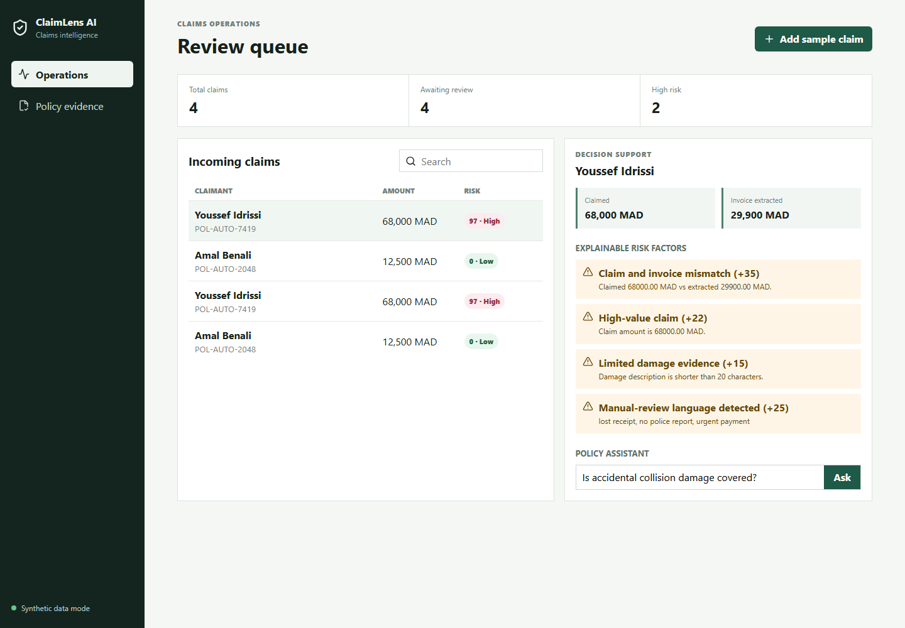
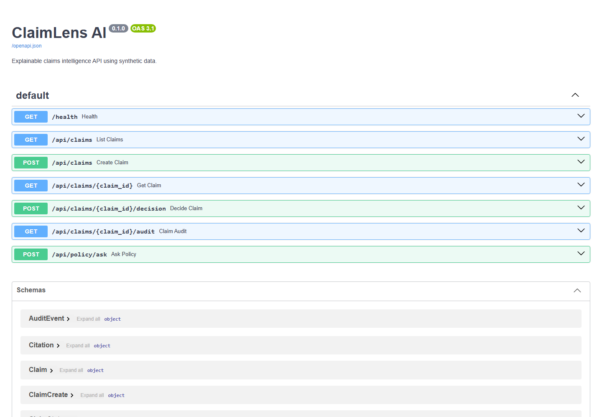

# ClaimLens AI

An explainable, full-stack insurance claims intelligence platform built with synthetic data. ClaimLens turns claim descriptions and invoice text into structured evidence, computes transparent risk factors, retrieves relevant policy clauses with citations, and records human decisions in an audit trail.


## Product preview

### Explainable review queue



### Interactive API



## Why this project exists

Current Data/AI roles increasingly ask engineers to ship reliable products, not isolated notebooks. ClaimLens demonstrates Python, SQL data modeling, API design, RAG-style retrieval, explainability, React, Docker, automated testing, CI/CD, and production-minded documentation in one coherent business workflow.

## Current MVP

- Create and list synthetic motor claims.
- Extract an invoice amount from unstructured text.
- Calculate a deterministic risk score with evidence for every factor.
- Retrieve relevant policy clauses and return explicit citations.
- Record approve/reject/review decisions with an audit trail.
- Explore the workflow through a responsive React operations dashboard.
- Validate critical behavior through API tests and GitHub Actions.

## Architecture

```text
React + Vite  --->  FastAPI  --->  SQLite
                         |             |
                         |             +-- Claims + audit events
                         v
                  Policy retrieval
                  with citations
```

Read the detailed [architecture notes](docs/architecture.md) and [explainability decision](docs/decisions/0001-explainable-first.md).

## Run locally

### Backend

```bash
python -m venv .venv
source .venv/bin/activate  # Windows: .venv\Scripts\activate
pip install -r backend/requirements.txt
uvicorn backend.app.main:app --reload --port 8000
```

API documentation: http://localhost:8000/docs

### Frontend

```bash
cd frontend
npm install
npm run dev
```

Dashboard: http://localhost:5173

### Docker

```bash
docker compose up --build
```

## Test

```bash
pytest backend/tests -q
cd frontend && npm run build
```

## Example API request

```bash
curl -X POST http://localhost:8000/api/claims \
  -H "Content-Type: application/json" \
  -d '{
    "claimant": "Amal Benali",
    "policy_number": "POL-AUTO-2048",
    "incident_description": "Rear bumper damaged in a low-speed collision.",
    "damage_description": "Visible bumper crack and damaged parking sensor.",
    "claimed_amount": 12500,
    "invoice_text": "Repair estimate TOTAL MAD 12 500.00"
  }'
```

## Safety and limitations

- This is decision support, not an autonomous insurance decision-maker.
- Risk rules are illustrative and are not validated actuarial or fraud models.
- Policy clauses and claims are synthetic.
- The local retrieval layer is intentionally transparent; an evaluated LLM integration is planned, not falsely presented as complete.

## Roadmap

- Document upload, OCR, and schema-constrained extraction.
- Image-based damage evidence with an evaluation dataset.
- PostgreSQL and object storage adapters.
- RAG evaluation, tracing, and cost/latency metrics.
- MCP tools for policy search and claim lookup.
- Azure deployment and infrastructure as code.

## License

MIT
